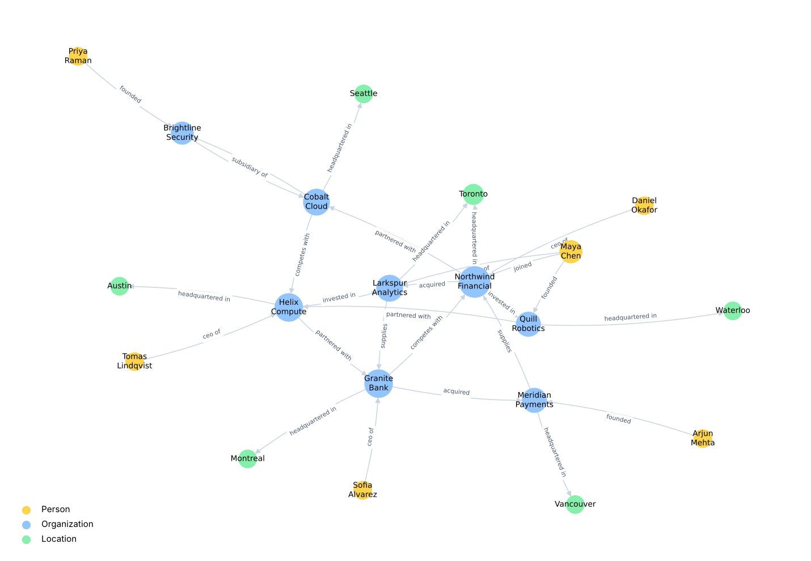
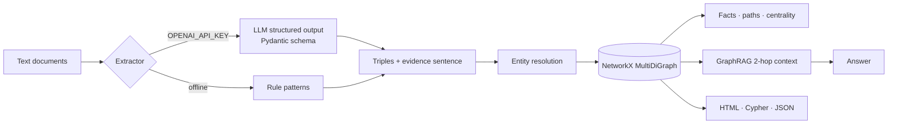

# 🕸️ Knowledge Graph Builder

**Turn unstructured text into a queryable, traceable knowledge graph, and use it for multi-hop GraphRAG question answering.**

[](https://github.com/silverlookz/knowledge-graph-builder/actions)     

Vector search is good at "find me passages like this", but weak at questions that need *connecting* facts across documents: "Who runs the company that acquired our supplier?" This project builds the structure that makes those questions answerable:

- **Extraction:** typed entities (Person, Organization, Location) and 10 business relations (acquired, CEO of, supplies, invested in, ...). LLM structured output when a key is set; a deterministic rule extractor otherwise.
- **Entity resolution:** "Cobalt Cloud Inc.", "cobalt cloud" and "Cobalt" collapse into one node.
- **Provenance on every edge:** each relation stores the sentence it came from, so any answer can be audited.
- **Graph analytics:** shortest connection between entities, PageRank centrality, neighbourhood facts.
- **GraphRAG:** pull the 2-hop neighbourhood of entities named in a question and answer from those facts only.
- **Exports:** interactive HTML (pyvis), Neo4j Cypher script, and JSON node-link format.

> The corpus is a set of *fictional* business news briefs. All companies and people are invented.

---



## Pipeline



## What it can answer

```text
>>> kg.path("Priya Raman", "Granite Bank")
Priya Raman -[FOUNDED]-> Brightline Security
Brightline Security -[SUBSIDIARY_OF]-> Cobalt Cloud
Northwind Financial -[PARTNERED_WITH]-> Cobalt Cloud
Granite Bank -[COMPETES_WITH]-> Northwind Financial

>>> answer(kg, "Who is the CEO of the company that acquired Larkspur Analytics?")
Most relevant facts: Northwind Financial acquired Larkspur Analytics;
Maya Chen ceo of Larkspur Analytics; Daniel Okafor ceo of Northwind Financial.

>>> kg.central_entities(3)
[('Northwind Financial', 0.1295), ('Helix Compute', 0.1044), ('Granite Bank', 0.1034)]
```

The CEO question is the multi-hop case that plain vector retrieval tends to miss: the acquisition and the CEO live in different sentences, and the graph joins them.

## Quickstart

```bash
git clone https://github.com/silverlookz/knowledge-graph-builder.git
cd knowledge-graph-builder
python -m venv .venv && source .venv/bin/activate
pip install -r requirements.txt

PYTHONPATH=src python -m kg_builder.graph      # build + write output/graph.{html,cypher,json}
streamlit run app/streamlit_app.py             # paste any text and explore the graph live
pytest
```

Open `output/graph.html` in a browser for the interactive view (hover an edge to see its evidence sentence).

### Load into Neo4j

```bash
cat output/graph.cypher | cypher-shell -u neo4j -p <password>
```
```cypher
MATCH (p:Person)-[:CEO_OF]->(o)<-[:ACQUIRED]-(buyer) RETURN p.name, o.name, buyer.name;
```

## Project structure

```
├── src/kg_builder/
│   ├── extract.py   # rule + LLM extractors -> Triple(subject, relation, object, evidence)
│   ├── graph.py     # entity resolution, graph build, queries, exports
│   └── qa.py        # GraphRAG answering over 2-hop neighbourhoods
├── app/             # Streamlit explorer
├── data/corpus/     # fictional sample text
└── tests/
```

## Design notes

- **Why keep a rule extractor?** It makes the graph deterministic for tests and CI, and it is a useful baseline: you can measure what the LLM extractor adds in precision/recall on your own labelled sentences.
- **Why MultiDiGraph?** Two entities can share several relations (a company can both *invest in* and later *acquire* another), and direction matters for most of them.
- **Scaling up:** swap NetworkX for Neo4j or a graph database as the system of record, and run extraction as a batch job with the LLM extractor plus human review on low-confidence triples.

## License

MIT
